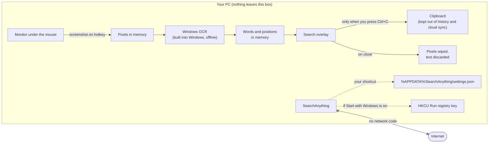
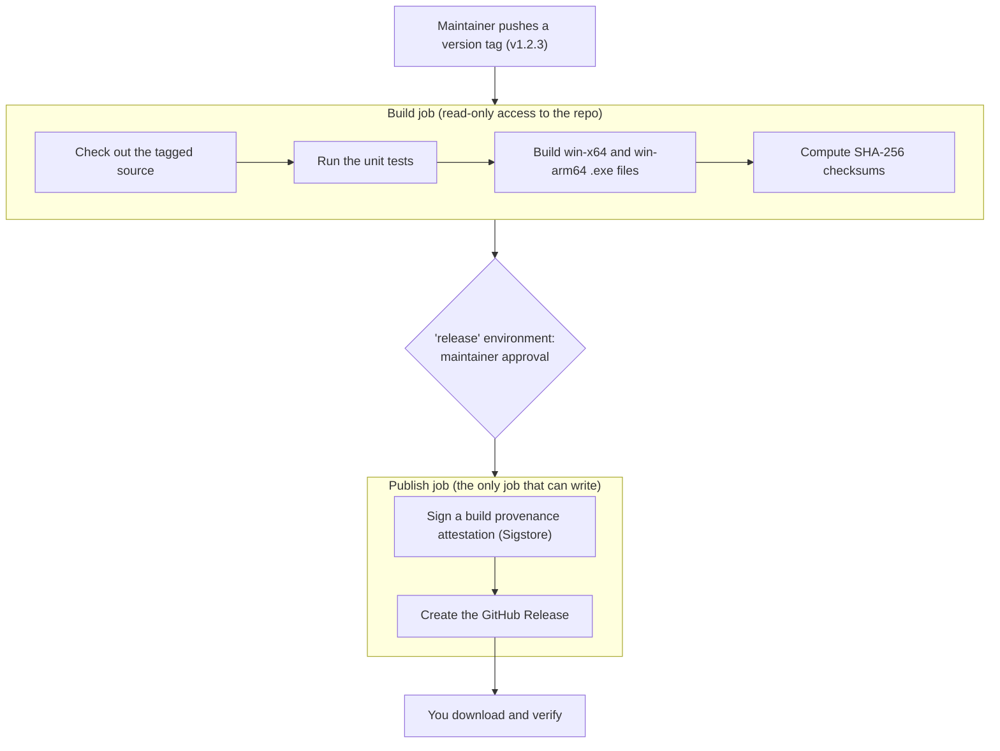

# Security

SearchAnything reads your screen, so you should be able to trust it with whatever is on it. This page explains what the app can and can't touch, how releases are built, how to check a download yourself, and how to report a problem.

**In short:** SearchAnything has no network code, never writes screenshots to disk, runs without administrator rights, and has no third-party runtime dependencies. Releases are built in GitHub Actions straight from this repository, with a signed provenance record you can verify.

## Reporting a vulnerability

Please **don't open a public issue** for a security problem. Report it privately through [GitHub's private vulnerability reporting](../../security/advisories/new) on this repository.

Include what you found, how to reproduce it, and the version (shown in the `.exe` file properties). You should get a reply within 7 days. Fixes ship in a new release, and the advisory is published once users can update.

| Version | Supported |
|---|---|
| Latest release | Yes |
| Older releases | No, please update |

## What the app can access



| SearchAnything does | SearchAnything does not |
|---|---|
| Capture one monitor when you press the shortcut or click the tray icon | Capture in the background, on a timer, or while closed |
| Keep the screenshot and its text in memory while the search is open, then wipe the pixels | Save screenshots or recognized text to disk |
| Copy text to the clipboard only when you press Ctrl+C or Ctrl+Shift+C | Put copied text in Win+V history or the cloud clipboard |
| Save your shortcut to `%APPDATA%\SearchAnything\settings.json` | Store anything else, keep logs, or collect telemetry |
| Add one per-user `Run` value if you turn on **Start with Windows** | Ask for administrator rights, install services or drivers |
| Use the OCR engine built into Windows | Download AI models, or send images anywhere |

The only exception to "nothing on disk" is a developer tool. `SearchAnything.exe --selftest report.txt image.png` reads **an image file you give it** (never your screen) and writes its text to a **new** report file. It refuses to overwrite an existing file.

## How releases are built



- **Built from source you can read.** Every release is built by [`.github/workflows/release.yml`](.github/workflows/release.yml) from the tagged commit. No one uploads binaries by hand.
- **Least-privilege CI.** Workflows default to read-only tokens. Tests and build tools run without permission to change the repository or its releases. Only the final publish step can write, and only after approval.
- **Pinned tooling.** Every GitHub Action is pinned to a full commit SHA, so a moved tag upstream can't change what runs. NuGet packages come only from nuget.org (`nuget.config` clears every other source) at exact versions. Dependabot proposes updates as reviewable pull requests.
- **Tiny dependency surface.** The app uses only .NET and Windows APIs. The only NuGet packages are test tools (xUnit and the .NET test SDK), and they are not part of the `.exe`.

## Verify your download

Pick whichever you're comfortable with. Each one is enough on its own.

**1. Check the build provenance (strongest).** It proves the file was built by this repository's release workflow from a specific commit. With the [GitHub CLI](https://cli.github.com/):

```powershell
gh attestation verify SearchAnything-win-x64.exe --repo glinco/SearchAnything
```

**2. Compare the checksum.** In PowerShell, compare the output with the matching line in `SHA256SUMS.txt` from the same release:

```powershell
(Get-FileHash .\SearchAnything-win-x64.exe -Algorithm SHA256).Hash.ToLower()
```

The checksum file sits next to the `.exe` on the release page. It catches a corrupted download, but someone who could replace one file could replace both. That's why the attestation above is the stronger check.

**3. Build it yourself.** With the [.NET 10 SDK](https://dotnet.microsoft.com/download/dotnet/10.0):

```powershell
dotnet test SearchAnything.slnx
dotnet publish src/SearchAnything -c Release -r win-x64 -o publish
```

### Check that it stays offline

You don't have to take our word for it:

- **Read the code.** It's about 1,500 lines. Searching `src/` for `Http`, `Socket` or `WebClient` finds nothing.
- **Watch it.** Open **Resource Monitor → Network** while you use the app. SearchAnything never shows up.
- **Block it.** Add an outbound Windows Firewall rule for `SearchAnything.exe`. The app works exactly the same.

## Known limitations

These are known and accepted. We list them so you can judge the risk yourself.

| Limitation | What it means for you | Plan |
|---|---|---|
| The `.exe` is not code-signed yet | Windows SmartScreen warns on first run. Use the provenance check above to know the file is genuine. | Code signing is planned. |
| The single-file `.exe` unpacks a few Windows/.NET DLLs to `%TEMP%\.net\SearchAnything\` | Another program running as **you** could tamper with them. Such a program could already read your screen, so this adds no new access. | Consider an unpacked zip release. |
| Anything you copy is plain text in the clipboard | The app you paste into receives the text, as with any copy. | By design. |
| The overlay shows a frozen image of your screen | Anyone looking at your screen sees what you already had on it. It closes as soon as you click away. | By design. |

## Security review

The codebase had a full manual security review on 2026-10-26. It found no critical or high issues. Every finding was fixed or is listed as a known limitation above.

| ID | Finding | Severity | Status |
|---|---|---|---|
| M1 | Release workflow trusted mutable action tags with a write token | Medium | Fixed: SHA-pinned actions, read-only build job, approval-gated publish job |
| M2 | Unsigned binaries; checksums from the same place as the binaries | Medium | Partly fixed: signed provenance attestations; code signing planned |
| L1 | Self-test mode could save live screen text to any file | Low | Fixed: image input only, never overwrites |
| L2 | Copied text went into clipboard history and cloud sync | Low | Fixed |
| L3 | Single-instance names could be taken by other programs | Low | Fixed: session- and user-scoped names, rate-limited notices |
| L4 | Native DLL loading and extraction folder | Low | Partly fixed: P/Invoke limited to System32; extraction listed above |
| L5 | CI token scope and dependency updates unmanaged | Low | Fixed: read-only CI, Dependabot |
| I1 | Raw exception messages shown to users | Info | Fixed |
| I2 | Screenshots stayed in memory after closing | Info | Fixed: pixels wiped on close |
| I3 | Release builds embed debug symbols | Info | Accepted: helps crash reports, no secrets in an open-source build |

## For contributors

- Keep the app offline. A pull request that adds network access, telemetry, or writes screen content to disk needs a strong reason and an update to this page.
- Don't add runtime NuGet dependencies without discussion in an issue first.
- New GitHub Actions must be pinned to a full commit SHA, with the version in a comment.
- Never commit credentials. The repository's `nuget.config` intentionally ignores your machine's private feeds.
